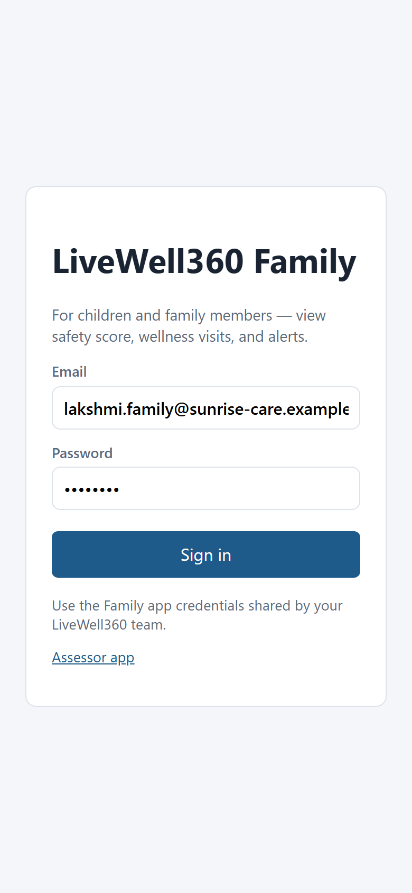
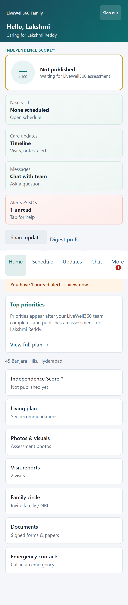
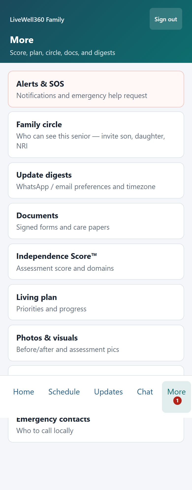
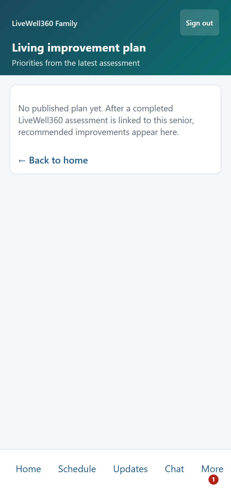
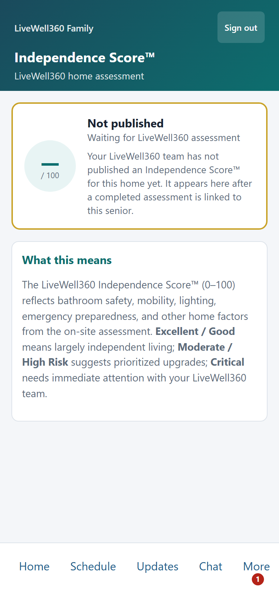
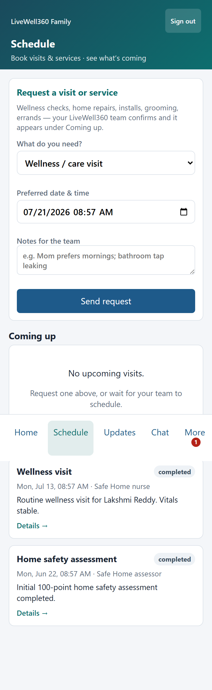
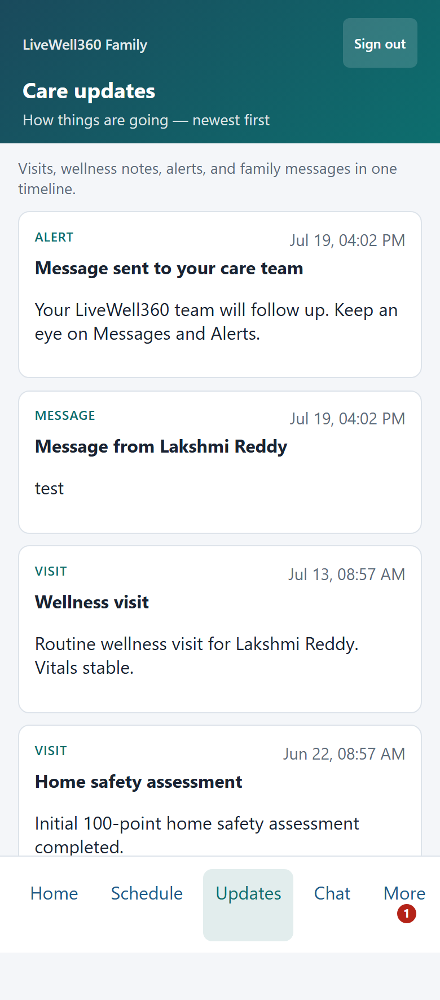
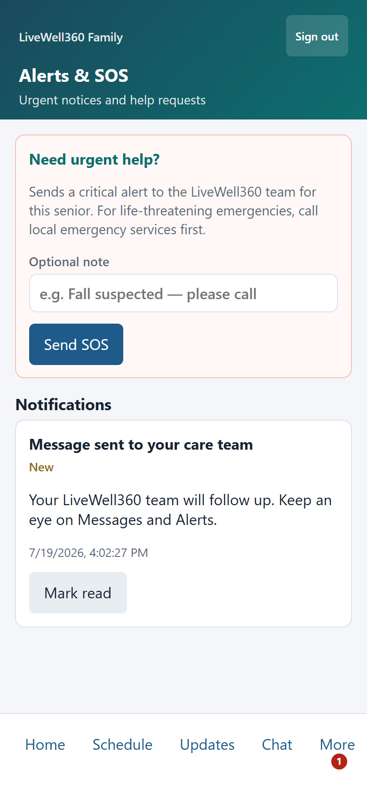
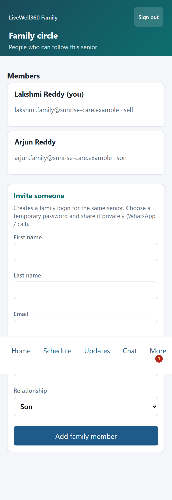
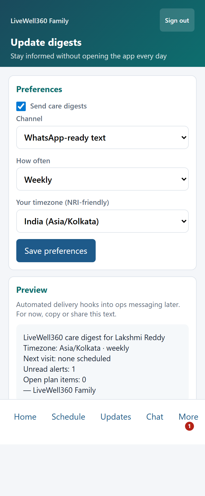

# Kushalaya — Family portal user guide

**Audience:** Family members and caregivers linked to one or more seniors (role `ELDER_PORTAL`)  
**App:** `/livewell/family` (PWA — Add to Home Screen on mobile)  
**Ops host:** `https://ops.kushalaya.com` · Marketing: `https://www.kushalaya.com`

**Demo logins** (password `demo1234`):

| Email | Typical use |
|-------|-------------|
| `lakshmi.family@sunrise-care.example` | Linked to Lakshmi (and may include household links) |
| `arjun.family@sunrise-care.example` | Son — often linked to **more than one** senior (use **Viewing**) |
| `clairview.family@sunrise-care.example` | Padmaja / Clairview household |

This guide covers the **Kushalaya Family** app only (Independence Score™, living plan, visits, care hub).  
Legacy WorkforceOS `/elder/*` messaging/invoices (sibling product) are described in [FAMILY_PORTAL_GUIDE.md](../FAMILY_PORTAL_GUIDE.md) — those routes are **not** the LiveWell family PWA.

---

## 1. Getting access

1. Your Kushalaya team creates a family login **or** invites you from **Family circle**.  
2. Open **`/livewell/family/login`** and sign in with email + password.  
3. You land on **Home**. Use **Sign out** on shared devices.

There is no public self-registration page in this app; access is invite/seed based.



---

## 2. Navigation

### Bottom bar (always available)

| Tab | Route | What it does |
|-----|-------|----------------|
| **Home** | `/livewell/family/dashboard` | Score snapshot, pathway, next visit, share update, top priorities, score history, visual previews |
| **Schedule** | `/livewell/family/schedule` | Upcoming & recent visits; **request a service** |
| **Updates** | `/livewell/family/updates` | Care timeline (visits, wellness, alerts, messages, requests) |
| **Chat** | `/livewell/family/messages` | Two-way messages with the Kushalaya care team |
| **More** | `/livewell/family/more` | Everything else (badge shows unread alerts) |





### Under **More**

| Page | Route | Purpose |
|------|-------|---------|
| **Alerts & SOS** | `/livewell/family/alerts` | Notifications; mark read; **SOS** emergency request |
| **Family circle** | `/livewell/family/circle` | Who can see this senior; invite another relative |
| **Update digests** | `/livewell/family/digests` | Channel / cadence / timezone; WhatsApp-ready preview |
| **Documents** | `/livewell/family/documents` | Signed customer forms for the senior |
| **Independence Score™** | `/livewell/family/safety` | Full score, domains, bands |
| **Living plan** | `/livewell/family/plan` | Priorities, projected score, indicative costs, status |
| **Photos & visuals** | `/livewell/family/photos` | Assessment photos + **approved** AI before/after |
| **Wellness reports** | `/livewell/family/wellness` | Visit / wellness summaries from the team |
| **Emergency contacts** | `/livewell/family/contacts` | Tap-to-call contacts from the senior’s profile |

Also available:

| Page | Route | Purpose |
|------|-------|---------|
| **Visit history** | `/livewell/family/visits` | Past visits list |
| **Visit detail** | `/livewell/family/visits/{id}` | Notes + **experience rating** after a visit |

---

## 3. Multiple seniors (Viewing)

One family login can be linked to **several** seniors.

- When more than one senior is linked, the header shows **Viewing** with a dropdown.  
- Switching reloads the app for that senior (score, plan, visits, chat context, etc.).  
- Staff can add links with `POST /api/v1/home-safety/care/elders/{elder_id}/family-links` or via seed/demo data.  
- Circle invites copy the inviter’s household links so the new member sees the same seniors.

---

## 4. Independence Score™ & living plan

### Score

- Published **0–100 Independence Score™** with domain breakdown and history.  
- Appears on **Home** and in detail under **More → Independence Score™**.  
- Only updates when the assessor **completes** an assessment and it is published to the client (see §9).

### Care pathway

- Home may show a **membership / pathway** label (e.g. Independent Living) and ECM note when published from the assessment.

### Living plan

- **More → Living plan** lists improvement priorities from the last published assessment.  
- Items show status (**Open / Scheduled / Done**), indicative cost notes, and projected score impact.  
- Staff set statuses on **Admin → LiveWell → Visits** (Family living plan panel). Done items leave Home “top priorities”.  
- Republishing an assessment keeps staff statuses where possible.





### Indicative costs (not checkout)

- Plan and Home may show **estimated** product/install ranges.  
- There is **no** family quote accept / pay / invoice flow in this app yet.

---

## 5. Schedule, visits & service requests

### Schedule

- See **upcoming** and **recent** visits.  
- **Request a service** (wellness, repair/install, nurse/PT, grooming, errand, other).  
- Cancel a request that is still pending.  
- Staff **confirm** (may create a visit) or **decline** on the staff Visits page.



### Visits

- Full history under `/livewell/family/visits`.  
- Open a visit to read detail and submit an **experience rating** after completion.

### Wellness

- **More → Wellness reports** shows summaries the team published from care visits.

---

## 6. Care hub (chat, updates, alerts, SOS)

| Feature | How to use |
|---------|------------|
| **Updates** | Timeline of care activity for the active senior |
| **Chat** | Message the care team; replies appear here and in Updates |
| **Alerts** | Agency/system notifications; mark as read; unread count on **More** |
| **SOS** | On Alerts — raises a **critical** incident/alert for the care team (use for true emergencies) |





---

## 7. Family circle & digests

### Family circle

- See who else can access this senior.  
- **Invite** by email — creates (or links) a family login with a temporary password and shares the household elder links.  
- Good for son/daughter/NRI relatives who need the same portal.



### Digests

- Set preferred **channel**, **cadence**, and **timezone**.  
- Open the **preview**, then copy or use the device share sheet for WhatsApp/email.  
- Digests complement (do not replace) live Chat and Alerts.



---

## 8. Photos, AI visuals, documents & contacts

| Feature | Notes |
|---------|--------|
| **Assessment photos** | Room / finding photos from the KAA |
| **AI before/after** | Only concepts with **human review = approved** and real (non-stub) images |
| **Documents** | Wet-signed / uploaded customer forms linked to the senior |
| **Emergency contacts** | From the client profile — tap to call |

Assessor approves AI concepts on the assessment AI visualizations flow before families see them.

---

## 9. When family data appears (publish)

Family sees a published score and plan after:

1. Assessor **completes** the KAA (100% applicable checklist + Save), signed in to WorkforceOS, and  
2. The assessment is linked to a **client** (or an open lead that is **converted** — conversion absorbs the lead into the client), and  
3. Publish runs (automatic on complete when linked; staff can **Republish to family** on the client).

If Home still says not published:

- Confirm the family user is linked to the correct senior (and **Viewing** that senior if multi-elder).  
- Confirm the assessment synced to the server (assessor signed in).  
- Ask staff to open the client and **Republish** the latest completed assessment.

---

## 10. Share update (NRI-friendly)

On **Home**, tap **Share update**:

- Uses the device share sheet when available, or  
- Copies a short WhatsApp-ready brief (score, pathway, top priorities).

---

## 11. Install as an app (PWA)

On a phone browser, use **Add to Home Screen** / Install.  
The family app has its own manifest and service worker for a standalone experience.

---

## 12. What this app does **not** include (yet)

| Topic | Status |
|-------|--------|
| Pay invoices / online billing | Not in LiveWell family PWA |
| Accept / pay live product quotes | Indicative plan costs only |
| PDF family report download | Planned |
| Public self-registration page | Invite / staff seed only |

---

## 13. Related docs

| Doc | Contents |
|-----|----------|
| [livewell/README.md](./README.md) | URLs, assessor pipeline, admin |
| [DEMO_USERS.md](../DEMO_USERS.md) | Demo emails / passwords |
| [SAFEHOME_SEED.md](../SAFEHOME_SEED.md) | Seed & purge |
| [livewell360/KAA_SPEC.md](../livewell360/KAA_SPEC.md) | Independence Score™ product constitution |
| [FAMILY_PORTAL_GUIDE.md](../FAMILY_PORTAL_GUIDE.md) | Legacy WorkforceOS `/elder/*` guide (sibling product) |

### Refreshing screenshots

Mobile captures live under `docs/livewell/images/family/`. Regenerate from a machine with Playwright:

```bash
cd frontend
node scripts/capture-family-docs.cjs
# optional: FAMILY_DOC_BASE=https://ops.kushalaya.com
```
